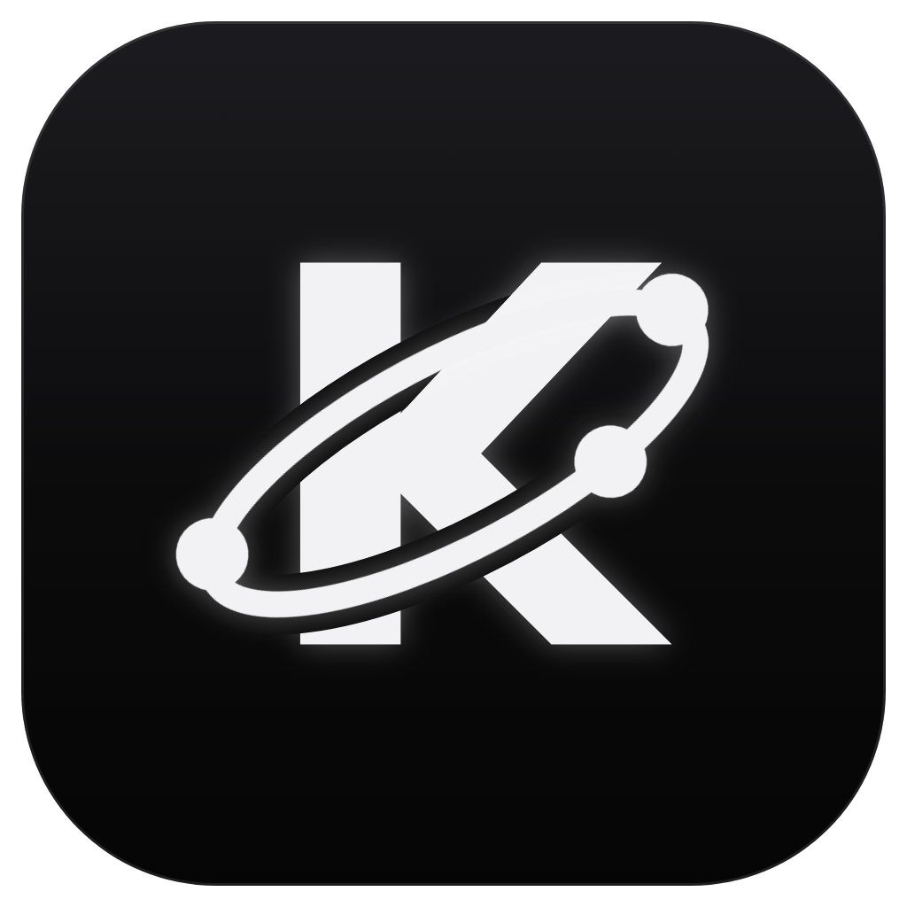

  

<h1 align="center">Kosmos</h1>

  <b>One fast, clean home for all your PC games.</b> 
  Steam, Epic Games and every other launcher together in one lightweight app.

  <a href="https://github.com/0kosmos/kosmos/releases/latest"><b>⬇ Download the latest version</b></a>
  &nbsp;·&nbsp;
  <a href="https://ko-fi.com/0kosmos">☕ Support on Ko-fi</a>

---

## Why Kosmos?

Kosmos brings your Steam games, your Epic Games library and any other game or app on your
PC together in one simple app. Your games still launch through Steam, Epic or their own
program. Kosmos just gives you a better place to find, organize and play them.

- **Made for every PC.** Kosmos is built to run smoothly on lower-end PCs too. It installs
  small, uses little memory and does almost nothing in the background.
- **Fast everywhere.** Browsing your library, the store or the market feels quick, with no
  lag. Data is cached and loaded only when you need it.
- **One place, every launcher.** No more switching between five launchers to find a game.
- **Safe.** You sign in on Steam's own website. Kosmos never sees your password and never
  touches your games.
- **Your way.** Four themes, 12 accent colors, a sidebar you can reorder and resize, and a
  "Reduce motion" switch that turns every animation and effect off.

## Everything in one place

Steam, Epic Games, Rockstar Games, Ubisoft Connect, EA app, Battle.net, GOG, Riot Games and
Amazon Games, plus any game or app from your PC that you add yourself.

## Features

| | |
|---|---|
| 🎮 **Library** | Games from every launcher and your own games together, with Play and Install buttons. |
| 🔎 **Search & smart filters** | Installed, not installed, played, never played, recently played, Steam tags and launcher. |
| ⭐ **Favorites & hidden games** | Star the games you love, hide the ones you don't want to see, bring them back any time. |
| 💡 **Rediscover games** | Find games you forgot you had, like free games you claimed and never opened. |
| 📄 **Game pages** | Details, screenshots, trailers, reviews and news, in a clean layout. |
| 🏷️ **Store** | Steam deals with filters and search, upcoming games with release dates, this week's free Epic games. |
| ♡ **Wishlists** | Save games from the Store and items from the Market. |
| 🎒 **Inventory** | Your Steam items for every game, with Market prices and what your inventory is worth. |
| 📈 **Market** | Search the Steam Community Market, with smart filters for games like Counter-Strike 2. |
| 📸 **Screenshots** | All your Steam screenshots in one place, ready to save or send to a friend. |
| ⬇️ **Downloads** | Installs and updates from Steam and Epic, every other launcher's installed games, real sizes on disk and a dot when something needs an update. |
| 👥 **Friends & Groups** | Who's online, what they're playing, and your groups. |
| 💬 **Discord** | Show what you're doing in Kosmos on your Discord profile. |
| 🎨 **Themes** | Black, Dark grey, Grey and White, with 12 accent colors. |
| 🔄 **Always up to date** | Kosmos tells you when a new version is out, updates in one click and shows what's new. |

## Requirements

- Windows 10 or 11, 64-bit
- A Steam account for the Steam features (library, store, market, friends…)
- Microsoft Edge WebView2 (already part of Windows 10/11; the installer adds it if missing)

## Install

1. Download `Kosmos_x.y.z_x64-setup.exe` from the
   [latest release](https://github.com/0kosmos/kosmos/releases/latest).
2. Run it.
3. Windows may show **"Windows protected your PC"**, because Kosmos isn't code-signed yet.
   Click **More info → Run anyway**.

After that, Kosmos updates itself: it tells you when a new version is out and installs it
in one click.

## Safe and private

- You sign in on **Steam's own website**. Kosmos never sees or stores your password.
- Kosmos never injects into or modifies your games. They launch through Steam, Epic or
  their own launcher, exactly as before.
- Steam data is fetched through Kosmos's own small server, so no secret keys are stored on
  your PC.

## Support

Kosmos is free. If you like it and want to support its development, you can
[buy me a coffee on Ko-fi](https://ko-fi.com/0kosmos) ☕

---

Made with the help of Claude, an AI assistant by Anthropic. 
Kosmos is an independent project, not affiliated with Valve or Epic Games. Steam is a
trademark of Valve Corporation. Epic Games is a trademark of Epic Games, Inc.

